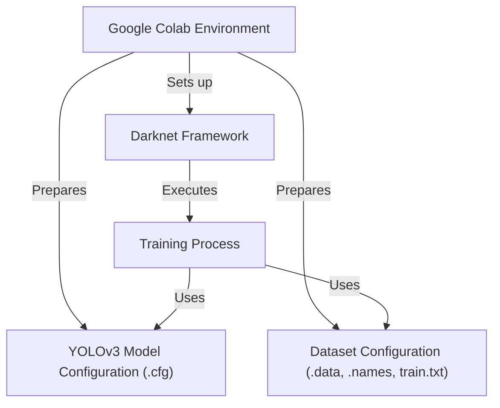

# Tutorial: yolov3

This project provides a guide and code to *train your own custom object detection model* using the powerful **YOLOv3** system.
It leverages the **Darknet Framework** engine and runs the entire **Training Process** within the **Google Colab Environment**,
allowing you to configure the model structure and dataset details using **Configuration Files**.

## Start with the training notebook

[**Open the notebook in Colab**](https://colab.research.google.com/github/RANJITHROSAN17/yolov3/blob/main/YOLOv3_Object_Detection.py.ipynb) · [Read it on GitHub](YOLOv3_Object_Detection.py.ipynb)

This is a **legacy YOLOv3/Darknet training tutorial**, not a maintained detector package or a comparison with current YOLO releases. Colab runtimes, CUDA and external downloads can change; GPU availability is not guaranteed. Read the setup cells before running them and adjust Drive/dataset paths for your own account.

Before paying for a long run, use a tiny, non-sensitive dataset to check class names, image/label pairs and config paths. A successful first milestone is reaching training with the intended data and writing a checkpoint; it is not a claim of detection accuracy. Keep validation/test images separate from training and review the licenses of Darknet, model weights and your dataset.

For a concrete contribution, report the first failing cell with its traceback, the notebook revision and Colab CUDA/Python versions; omit private Drive links and images.

## Visual Overview

## Chapters

1. [Google Colab Environment
](01_google_colab_environment_.md)
2. [Dataset Configuration (.data, .names, train.txt)
](02_dataset_configuration___data___names__train_txt__.md)
3. [YOLOv3 Model Configuration (.cfg)
](03_yolov3_model_configuration___cfg__.md)
4. [Darknet Framework
](04_darknet_framework_.md)
5. [Training Process
](05_training_process_.md)

---

## Maintainer

**[Ranjith Rosan](https://github.com/RANJITHROSAN17)** maintains this custom-dataset YOLOv3 training tutorial. YOLOv3, Darknet and their model weights are upstream work and retain their original authorship and license terms.
