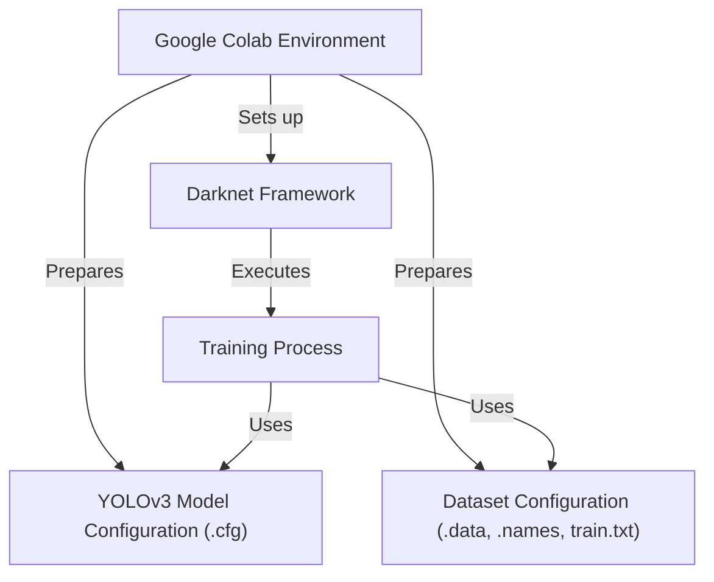

# Tutorial: yolov3

This project provides a guide and code to *train your own custom object detection model* using the powerful **YOLOv3** system.
It leverages the **Darknet Framework** engine and runs the entire **Training Process** within the **Google Colab Environment**,
allowing you to configure the model structure and dataset details using **Configuration Files**.


## Start with the training notebook

[**Open the notebook in Colab**](https://colab.research.google.com/github/RANJITHROSAN17/yolov3/blob/main/YOLOv3_Object_Detection.py.ipynb) · [Read it on GitHub](YOLOv3_Object_Detection.py.ipynb)

This is a **legacy YOLOv3/Darknet training tutorial**, not a maintained detector package or a comparison with current YOLO releases. Colab runtimes, CUDA and external downloads can change; GPU availability is not guaranteed. Read the setup cells before running them and adjust Drive/dataset paths for your own account.

### Quick start: verify detection without your own dataset

1. Open the notebook in Colab and run the build and pretrained smoke-test cells. They check out a pinned Darknet revision, build it (GPU when available, otherwise CPU), download approximately 35 MB of YOLOv3-tiny weights with a SHA-256 check, and run inference on Darknet's sample dog image.
2. Inspect the log and annotated image. The smoke test expects a `dog` detection, but it **does not** validate your own model or measure accuracy.
3. Optional local CPU smoke test on Linux/macOS with Python 3, Git, `make`, a C/C++ compiler and internet access:

   ```bash
   python3 scripts/smoke_yolov3_tiny.py --work-dir /tmp/yolov3-smoke
   ```

   This builds third-party Darknet and downloads weights; inspect their licenses first. The work directory retains the annotated `darknet/predictions.jpg`. Omit `--work-dir` to use and clean up a temporary directory. The smoke test was run on Linux CPU; Colab/GPU and other operating systems are not verified by it.

### Train and test a custom detector

The notebook does **not** mount Drive or start training by default. Unzip trusted images and labels yourself and use independent training and validation splits, for example:

```text
my_dataset/
  train/
    image001.jpg
    image001.txt
  valid/
    image101.jpg
    image101.txt
```

Each label line is `class_id x_center y_center width height` in normalized YOLO coordinates; an empty label file means an explicit negative image. Class IDs start at zero and must follow the notebook's class-name list. The notebook validates paths, class IDs, boxes and exact duplicate image bytes across splits; it does not verify image decoding, annotation quality or near-duplicate leakage. Split related frames or subjects together and reserve an additional untouched test set.

Mount Drive if needed, set `ENABLE_CUSTOM`, edit the paths and names, and run preflight. Set `RUN_TRAINING` only when ready: full YOLOv3 uses a roughly 162 MB Darknet-53 backbone download, can take hours, and may not save a checkpoint immediately. Store checkpoints on persistent storage and use a new backup directory when changing the config or class list. The custom inference and validation-mAP cells are separately opt-in and need matching trained weights. One image, a smoke test or decreasing loss is not evidence of accuracy.

### Tests and limitations

```bash
python3 -m unittest discover -s tests -v
```

These dependency-free tests cover config generation, dataset checks, safe download handling, inference failure propagation, and notebook/helper consistency; they use synthetic fixtures and do not train a model. The real tiny-model smoke test requires network access and external code/weights, and is intentionally not part of CI. YOLOv3/Darknet is a legacy stack; Colab, CUDA, dependencies and downloads may change. The current custom training and GPU/Colab paths have not been run end-to-end here. Report the first failing cell, traceback, notebook revision and CUDA/Python versions without sharing private Drive links, images, labels or credentials.

## Visual Overview



## Chapters

1. [Google Colab Environment
](01_google_colab_environment_.md)
2. [Dataset Configuration (.data, .names, train.txt)
](02_dataset_configuration___data___names__train_txt__.md)
3. [YOLOv3 Model Configuration (.cfg)
](03_yolov3_model_configuration___cfg__.md)
4. [Darknet Framework
](04_darknet_framework_.md)
5. [Training Process
](05_training_process_.md)

---

## Maintainer

**[Ranjith Rosan](https://github.com/RANJITHROSAN17)** maintains this custom-dataset YOLOv3 training tutorial. YOLOv3, Darknet and their model weights are upstream work and retain their original authorship and license terms.
